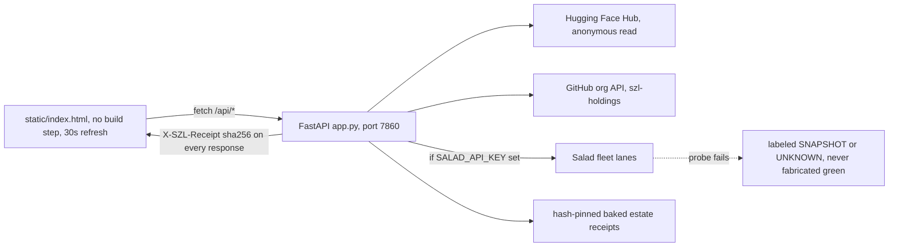

# SZL Frontier Console

Receipts-native observability console for the SZL Holdings governed-AI estate. One page: fleet, khipu receipts mesh, models, proofs, governance, standards.

Doctrine v11: deny by default, fail closed, honest UNKNOWN over fabricated green. Every /api/* response carries an X-SZL-Receipt header (sha256 of the raw body). If a live probe fails, the console shows a labeled SNAPSHOT or UNKNOWN, never a fabricated green.

## Stack

- Back end: FastAPI + uvicorn (app.py). Live probes: HF hub anonymous read, GitHub org API, Salad fleet when SALAD_API_KEY is set. Baked hash-pinned estate receipts.
- Front end: single-file static/index.html, no build step, dark mission-control theme, 30s auto-refresh.
- Deploy: Dockerfile (port 7860) for HF Spaces; any container host for szlholdings.com.

## Endpoints

| Route | Payload |
|---|---|
| /api/health | uptime, version, self sha256 of app.py |
| /api/estate | org stats (live), doctrine, links |
| /api/hf | live HF org inventory: models / datasets / spaces + runtime stages |
| /api/fleet | Salad fleet lanes (live if key set; else labeled snapshot) |
| /api/mesh | khipu receipts: scholar-v1 completion, outreach sends, proof results, mesh events |
| /api/governance | doctrine, trust ceiling, open/held gates, standards positions |

## Run locally

```bash
python -m pip install --require-hashes --only-binary=:all: -r requirements.lock
uvicorn app:app --port 7860
```

For pinned source tests, a no-network Docker smoke test and exact publication
hashes, see the [runtime smoke and publication hold](docs/operations/RUNTIME_SMOKE_AND_PUBLICATION_HOLD.md).
Matching `X-SZL-Receipt` authenticates no signer: it checks raw-body bytes only.

## Deploy to szlholdings.com

The container runs anywhere Docker runs. Recommended path: owner-gated Cloudflare onboarding (billing and DNS are owner-only per doctrine), point szlholdings.com at the console host, HTTPS via Cloudflare or Caddy. No secrets are required for public operation; SALAD_API_KEY (optional) unlocks live fleet telemetry.

## Intended use

- Receipts-native observability of the SZL Holdings governed-AI estate: fleet lanes, khipu receipts mesh, HF org inventory, models, proofs, governance posture, standards positions.
- A public demonstration surface for the fail-closed doctrine: every /api/* response carries a verifiable X-SZL-Receipt header (sha256 of the raw body).
- Read-only public operation; all public endpoints run on public data only.

## Out-of-scope use

- Not a control plane. The console observes; it cannot start, stop, or modify any fleet lane, model, or repository.
- Not an authentication, authorization, payment, or decision system over people.
- Point-in-time telemetry is not the system of record: the khipu receipts mesh is the durable record.
- No personal or confidential data; no adversarial use of estate telemetry.

## System architecture



## Evaluation and measured results

- Verified property, not a benchmark claim: every /api/* response carries the receipt header, and every failing probe renders a labeled SNAPSHOT or UNKNOWN (Doctrine v11: honest UNKNOWN over fabricated green).
- /api/health exposes a measurable self sha256 of app.py so the running build can be verified against source.
- No synthetic benchmark scores are claimed on this card.

## Evaluation limitations

- Telemetry is point-in-time (30s auto-refresh), not continuous.
- Fleet data requires SALAD_API_KEY; without it the panel renders a labeled snapshot.
- No load testing, SLA, or uptime data has been measured and published here.

## Ethical considerations

- Fail-closed by design: deny by default, honest UNKNOWN over fabricated green.
- Public data only; the console collects no personal data.
- Anti-deception commitment: state provenance (live, snapshot, unknown) on every panel.

## Deployment recommendations

- The image listens on port 7860. A passing local smoke is not a publication
  approval; the [revision-bound admission report](docs/operations/RUNTIME_SMOKE_AND_PUBLICATION_HOLD.md)
  records the parity, syntax and fleet holds.
- For szlholdings.com, use the owner-gated Cloudflare path described above (billing and DNS are owner-only per doctrine).
- Public operation needs no secrets; keep SALAD_API_KEY server-side only if live fleet telemetry is enabled.

Apache-2.0 aligned with the rest of the estate. (c) SZL Holdings.